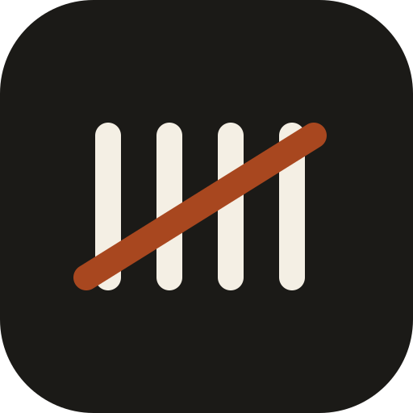

<div align="center">



# Droves

**Your running agents, from your phone.**<br>
Native Android, iOS and web client for a self-hosted herdr bridge.


</div>

Droves shows the workspaces, panes, agents, terminals, Git changes and files that
already exist on your machine. It has no agent runtime of its own: every action
goes through a bridge that you publish over a private mesh, a tunnel or a
reverse proxy of your choice.

The machine side is [herdr](https://github.com/herdrdev/herdr). The bridge in
`bridge/` fronts herdr's control socket, reads agent session files, and serves
the web build. See [Bridge contract](docs/bridge.md) for the RPC surface.

## Features

| Area | What you get |
| --- | --- |
| Inbox | Workspaces with waiting-agent tally, agent status and quick open |
| Agents | Agents known to the bridge, grouped by host |
| Terminal | ANSI frames, scrollback, shortcuts, paste; split, zoom, rename and close panes |
| Chat | Transcript with tool calls, search, attachments and prompt sending |
| Changes | Diffs, stage/unstage, pull, push, commit history and selected-file commits |
| Files | Browse, read, edit, create, move, delete and content search |
| Scout | Bridge-hosted assistant (omp, pi or any OpenAI-compatible endpoint) with sessions and model selection |
| Notifications | Completed, blocked and Scout activity; tapping one opens the related pane |
| Machines | Multiple saved bridges with per-bridge hosts |

## Quick start

Install the bridge on the machine that runs herdr. Linux and macOS:

```sh
curl -fsSL https://github.com/ihsan-ramadhan/droves/releases/latest/download/install.sh | sh
```

Windows:

```powershell
irm https://github.com/ihsan-ramadhan/droves/releases/latest/download/install.ps1 | iex
```

Then run the bridge on loopback and publish that port:

```sh
droves-bridge -addr 127.0.0.1:13030 -web ~/.local/share/droves/web
cat ~/.config/droves-bridge/token

# pick one provider (or configure your own reverse proxy):
droves-bridge expose -provider tailscale          # tailnet only
droves-bridge expose -provider tailscale-funnel   # public, see caveats below
droves-bridge expose token -provider cloudflared <TOKEN>
droves-bridge expose                              # show what is published
```

Provider details live in [Reachability](docs/reachability.md). `tailscale`
needs the `tailscale` CLI on the host. `cloudflared` needs the CLI
plus a remotely-managed tunnel token from Cloudflare, stored with mode `0600`
in the bridge state dir. Without a provider the bridge listens on loopback
only; anything that can forward HTTP to that port works, including Pangolin,
Netbird, an SSH reverse tunnel or your own reverse proxy. If the proxy serves
the app under a subpath, pass `-public-url https://host/subpath` so the client
resolves its API calls under the same prefix.

Get the client:

- **Android**: install
  [`droves-arm64.apk`](https://github.com/ihsan-ramadhan/droves/releases/latest/download/droves-arm64.apk)
  or [`droves-arm.apk`](https://github.com/ihsan-ramadhan/droves/releases/latest/download/droves-arm.apk).
- **iOS**: sideload [`droves.ipa`](https://github.com/ihsan-ramadhan/droves/releases/latest/download/droves.ipa)
  with SideStore, or use the web build.
- **Web**: open `https://<bridge-host>/droves/`.

Enter the published URL and token in the app, for example
`https://droves.example.com/`. `droves-bridge expose` prints the address when
the provider reports one. The web build must be opened from the bridge origin,
because the session cookie never leaves that site.

## Bridge CLI

| Command | Does |
| --- | --- |
| `droves-bridge` / `run [flags]` | run in the foreground (default) |
| `stop` | stop the managed service |
| `restart` | restart the managed service |
| `autostart` | show login/boot status |
| `autostart -enable` | install the systemd user unit, LaunchAgent or Scheduled Task |
| `autostart -disable` | remove it |
| `update -check` | report the newest release |
| `update` | download, verify SHA256, install and restart |
| `update -apply` | apply a binary staged because the running one was locked |
| `expose`, `expose status` | report the publishing provider and its URL |
| `expose -provider tailscale` | publish through the tailnet |
| `expose -provider cloudflared token <TOKEN>` | store a Cloudflare Tunnel token |
| `expose off` | remove this bridge's published route |
| `version` / `-version` | print version (`-version` is the installer alias) |
| `help` | list all commands and flags |

Each start or restart checks GitHub Releases in the background. A newer release
is verified against `SHA256SUMS.txt`, installed and the managed service is
restarted. Set `DROVES_NO_UPDATE_CHECK=1` to disable. `update` changes only the
binary; rerun the installer for web assets and APKs.

The app checks GitHub Releases directly on Android/iOS on cold start, with a
6-hour throttle for silent checks. Web uses the same-origin `update.json` served
by the bridge. SideStore handles iOS installs; the app only points to the latest
release.

## Configuration

| Setting | Where | Notes |
| --- | --- | --- |
| Bridge URL | Connect screen | The address your tunnel or proxy publishes, with a path if mounted under one |
| Access token | Connect screen | Exchanged for a session cookie, stored locally |
| Theme | Settings | Light, dark, follow system |
| Notifications | Settings | Completed, blocked and Scout activity; taps open the pane |
| Battery optimization | Settings (Android only) | Request exemption so agent alerts are not delayed |
| Autostart | `droves-bridge autostart` | Login/boot start for the bridge |
| `-public-url` / `DROVES_PUBLIC_URL` | Bridge flag | Address clients dial; its path sets the mount prefix |
| `-base-path` / `DROVES_BASE_PATH` | Bridge flag | Serve under a subpath when the proxy does not rewrite it |
| `-trusted-proxies` / `DROVES_TRUSTED_PROXIES` | Bridge flag | CIDRs whose `X-Forwarded-*` headers are honoured |
| `-expose` / `DROVES_EXPOSE` | Bridge flag | Provider at startup: `none`, `tailscale`, `tailscale-funnel`, `cloudflared` |
| `DROVES_NO_UPDATE_CHECK=1` | Environment | Disable background bridge updates |
| `DROVES_RELEASES_URL` | Environment | Override release download base URL |

Saved endpoints live in `shared_preferences`. No config file or compile-time
secret is baked into the app.

## iOS without the App Store

Droves needs a bridge URL and token before it can show anything, so App Review
is not a fit. Use SideStore or the web build.

1. Install `LocalDevVPN` from the App Store and SideStore with iloader.
2. Trust the developer profile, enable Developer Mode on iOS 16+, and refresh
   SideStore once.
3. Add `https://github.com/ihsan-ramadhan/droves/releases/latest/download/source.json`
   as a source, then install Droves.
4. Keep LocalDevVPN and SideStore background refresh active. A free Apple
   certificate expires after 7 days.

SideStore updates come from `source.json`; pull to refresh the source if no
update appears. iOS notifications are not wired yet.

## Security

The bridge is the security boundary. Prefer a private mesh or an identity-gated
proxy; a public tunnel without an access policy leaves only the bridge token
between the internet and terminal input, file writes and Git actions. Keep the
token secret and serve web from the bridge origin so the session cookie works.
The token is sent once to `/api/login`; after that the client uses the returned
cookie. A proxy that terminates TLS should set `X-Forwarded-Proto`, and only
proxies listed in `-trusted-proxies` (default loopback) may set forwarded
headers. Terminal input, file writes and Git actions go through bridge RPCs.
Nothing executes locally on the phone.

## Development

```sh
flutter pub get
flutter analyze
flutter test --exclude-tags live
flutter build apk --release --split-per-abi
flutter build web --release --base-href /droves/

cd bridge
go build ./...
go vet ./...
```

Live and golden checks:

```sh
flutter test --update-goldens test/golden_test.dart
flutter test --tags live --update-goldens test/live_render_test.dart
```

Release assets use stable names under `releases/latest/download/`: bridge
binaries, `droves-web.tar.gz`, Android APKs, `droves.ipa`, installers,
`update.json`, `source.json` and `SHA256SUMS.txt`. Signing, versioning and
publishing are documented in [Release](docs/release.md).

## License

Apache-2.0. See [LICENSE](LICENSE) and [NOTICE](NOTICE). Bundled fonts are
OFL-1.1; notices ship under Settings → Licenses. Droves bundles no herdr code.

[Docs](docs/) · [Bridge contract](docs/bridge.md) · [Release](docs/release.md) · [Design](DESIGN.md)
